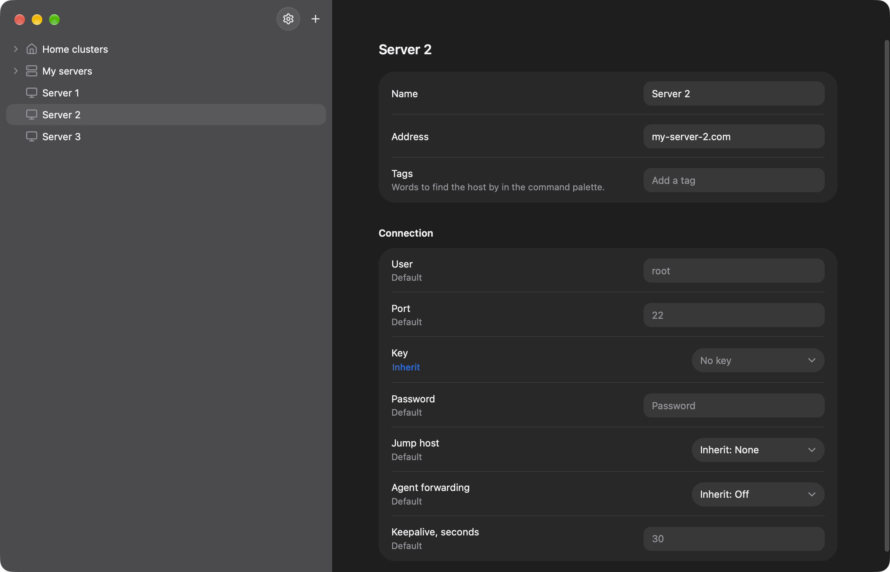

# CoolSSH


<p><strong>An SSH client that is a pleasure to work in.</strong></p>
<p>Open sessions in tabs and split panes, jump to any server from the command palette, and keep your hosts in folders. CoolSSH looks and feels at home on macOS, Windows and Linux.</p>
<p>
  <a href="https://github.com/dortanes/coolssh/releases/latest"></a>
  <a href="https://github.com/dortanes/coolssh/actions/workflows/ci.yml"></a>
  <a href="LICENSE"></a>
  
</p>
<p>
  <a href="#features">Features</a> ·
  <a href="#download">Download</a> ·
  <a href="#build-from-source">Build from source</a> ·
  <a href="ROADMAP.md">Roadmap</a> ·
  <a href="CONTRIBUTING.md">Contributing</a> ·
  <a href="#support-coolssh">Support</a>
</p>

<br clear="left">

<p align="center"></p>

## Features

- **Tabs and split panes.** Open several sessions in one window, side by side or stacked, and reconnect a dropped one in place.
- **Command palette.** Press ⌘K on macOS or Ctrl+Shift+K elsewhere to find a host by name, address or tag, or connect to `user@host` without saving it. Every shortcut can be changed in the settings.
- **Keys in one library.** Pick a key file, paste a key or generate one, then install its public key on a host from the host's menu.
- **Secrets stay in your keychain.** Passwords, passphrases and pasted keys are kept only in the system keychain, never in a file.
- **Careful with host keys.** CoolSSH checks every server against your `known_hosts` and asks before it trusts a new key. Password and keyboard-interactive logins work too.
- **Folders that pass settings down.** A folder sets the user, port, key, password, jump hosts, agent forwarding and keepalive for every host inside it, and a host overrides only what it needs. Folders nest, and you drag hosts and folders between them.
- **Hosts from other services.** A folder can fill itself from a connected service and stay in sync with it, filtered by group, with each host's status. NetBird is supported today.
- **At home on each system.** Liquid Glass on macOS, Mica on Windows 11 and a plain neutral theme on Linux.

## Download

Get the latest version from [Releases](https://github.com/dortanes/coolssh/releases/latest).

| Platform | File | Requirements |
| --- | --- | --- |
| macOS | `.dmg` | macOS 13 or later, Apple silicon or Intel |
| Windows | `.exe` installer | Windows 10 or later, 64-bit |
| Linux | AppImage, `.deb`, `.rpm`, Arch package | GTK 4 and WebKitGTK 6.0, as on Ubuntu 24.04 and Debian 13 |

- **macOS:** open the disk image and drag CoolSSH to Applications.
- **Windows:** the installer is not code-signed yet, so SmartScreen asks first: choose **More info**, then **Run anyway**.
- **Linux:** the deb, rpm and Arch packages install GTK 4 and WebKitGTK 6.0 for you.

On macOS, you can also install with Homebrew:

```sh
brew tap dortanes/coolssh https://github.com/dortanes/coolssh
brew install --cask dortanes/coolssh/coolssh
```

To update, run `brew update` and `brew upgrade --cask dortanes/coolssh/coolssh`.

Every release lists the SHA-256 of each file in `SHA256SUMS` and carries build provenance you can check with `gh attestation verify <file> --repo dortanes/coolssh`.

## Build from source

You need Go 1.27, Node.js 24 and pnpm 10. On Linux, also the GTK 4 and WebKitGTK 6.0 development packages (`libgtk-4-dev` and `libwebkitgtk-6.0-dev` on Debian and Ubuntu). On Windows, the WebView2 runtime, which ships with Windows 11, and [NSIS](https://nsis.sourceforge.io) for the installer. The Wails CLI is pinned in `go.mod`, so there is nothing else to install.

```sh
git clone https://github.com/dortanes/coolssh.git
cd coolssh
go tool wails3 build     # the app in bin/
go tool wails3 package   # the .app bundle, the installer or the Linux packages
```

[CONTRIBUTING.md](CONTRIBUTING.md) covers the development setup, the checks a pull request passes, translations and releases.

## Community

Report bugs and suggest features in [Issues](https://github.com/dortanes/coolssh/issues). Report vulnerabilities privately as described in [SECURITY.md](SECURITY.md).

## Support CoolSSH

CoolSSH is free and built in spare time. If it is useful to you, a donation helps keep it going. All the ways to donate are at [anthy.net/donate](https://anthy.net/donate).

## License

CoolSSH is released under the [MIT License](LICENSE).

---

<p align="center">
  If CoolSSH keeps your servers in order, please <a href="https://github.com/dortanes/coolssh">⭐ star the repository</a>.<br>
  It helps others find the project and keeps development going.
</p>
